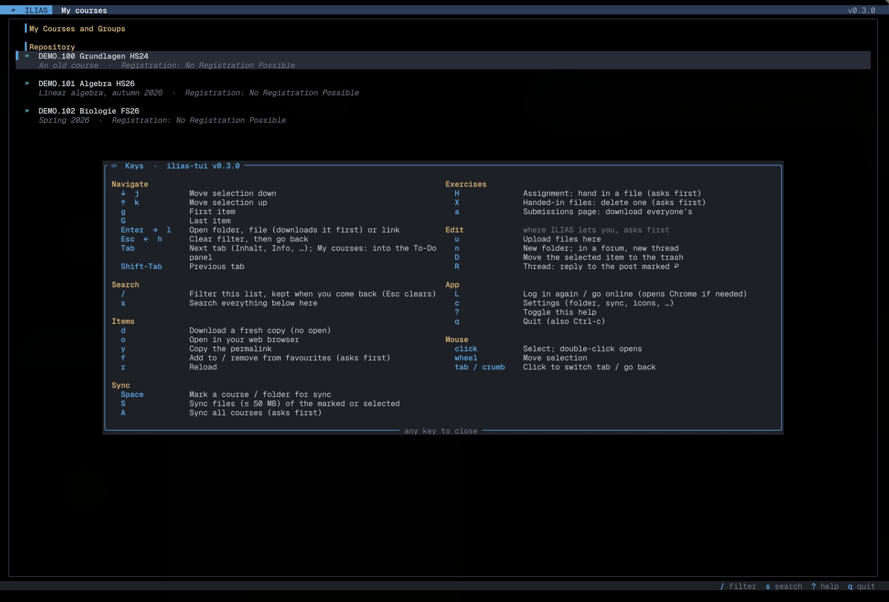

# ilias-tui

A terminal UI for [ILIAS](https://github.com/ILIAS-eLearning/ILIAS) 10, built with
[ratatui](https://ratatui.rs). It is set up for the
[HSLU ILIAS](https://elearning.hslu.ch/ilias/) (Keycloak + Switch edu-ID login), but works
with any ILIAS 10 that logs in through OpenID Connect. Runs on macOS, Linux and Windows.

> **Note:** The code and documentation were written with the help of AI (Claude by
> Anthropic). See [Disclaimer](#disclaimer).



## What it does

**Browse**
- My courses: your **favourites**, then your courses by year, with a **To-Do** panel of the
  assignments still to hand in.
- Courses, folders, forums and exercises the way ILIAS shows them: page text with its links,
  sections, tabs, every item of long "Show more" lists.
- **What's new** since your last visit (`● new`, `● new posts`); after a sync, counts on
  each course and folder lead you to it.
- Filter any list as you type (`/`), or search everything below here (`s`).

**Files**
- `Enter` downloads a file into the same folders as on ILIAS and opens it; the next time
  the saved copy opens at once.
- **Sync** whole courses (`S`, `A`): every file up to 50 MB, later only what changed, and
  never over files you edited. **Two-way sync** (settings, off by default) also uploads
  your new files and folders and your edits (in place of ILIAS' file), renames files you
  renamed, and moves files you deleted to the ILIAS trash; it shows everything first and
  you send it with `Enter`. See [Sync](#sync).
- Works **offline** with what it has seen before. See [Offline](#offline).

**Exercises and forums**
- Read assignments; hand in files (`H`) and delete them again before the deadline (`X`).
- Read forum threads; start a thread (`n`) or reply (`R`), written in your `$EDITOR`.
- For those who grade: every participant's submission, saved in one go (`a`).

**Editing** (where ILIAS lets you, e.g. as a lecturer or in a shared folder)
- Upload files (`u`), create folders (`n`), move items to the ILIAS trash (`D`). The keys
  that work on a page are named at the bottom of its frame.

Everything that changes something on ILIAS names what it sends where and asks first. See
[Security](#security).

## Install

You need:

- Rust 1.88 or newer, e.g. `brew install rust` or [rustup](https://rustup.rs) (on Windows,
  rustup with the MSVC build tools).
- Google Chrome or Chromium, only for the login window.
- A [Nerd Font](https://www.nerdfonts.com) in your terminal for the icons (or set
  `ILIAS_NERD_FONT=0`). On Windows 10 or newer, use Windows Terminal or another modern
  terminal.

```bash
cargo install --path .
```

## Usage

```bash
ilias-tui
```

On the first start, a Chrome window opens on the HSLU login. Log in with Switch edu-ID as
usual; when the window lands back on ILIAS, it closes and your courses load. Later starts
show your cached courses at once and renew the session in the background; Chrome only
opens again when the HSLU login itself has expired.

| Command               | What it does                                             |
| --------------------- | -------------------------------------------------------- |
| `ilias-tui`           | Start the TUI (logs in first if needed; offline if ILIAS can't be reached) |
| `ilias-tui --offline` | Start offline: cached pages and saved files only, nothing is sent |
| `ilias-tui login`     | Force a fresh browser login                              |
| `ilias-tui logout`    | Log out on ILIAS and delete the session and page cache   |
| `ilias-tui ls [URL] [--deep]` | Print a container's items as `kind<TAB>ref_id<TAB>title` (default: my courses); `--deep` prints everything below it |
| `ilias-tui get URL…`  | Download files, e.g. `goto.php/file/123`, straight into the download folder (it doesn't know their ILIAS folders) |
| `ilias-tui todo`      | Print the assignments still to hand in, soonest first    |
| `ilias-tui show URL`  | Print how a page is parsed (for debugging)               |
| `ilias-tui dump URL`  | Print the HTML ILIAS returns (for debugging)             |
| `ilias-tui --version` | Print the version                                        |

`URL` can be absolute or relative to the ILIAS root, e.g. `ilias-tui ls goto.php/crs/123`.

### Keys

| Key             | Action                                          |
| --------------- | ----------------------------------------------- |
| **Navigate**    |                                                 |
| `↑ ↓` / `k j`   | Move selection; scroll in a forum thread        |
| `g` / `G`       | First / last item                               |
| `Enter` `→` `l` | Open folder, forum, thread or exercise; open file (downloads it the first time); open a link or anything else in the browser (asks first for links to other sites) |
| `Esc` `←` `h`   | Clear filter, then go back                      |
| `Tab` / `Shift-Tab` | Next / previous tab (Inhalt, Info, …); on My courses, in and out of the To-Do panel |
| **Search**      |                                                 |
| `/`             | Filter the current list: every word must appear, in any order; `Enter` opens the match |
| `s`             | Search everything below here (on My courses: all courses), then filter the results |
| **Items**       |                                                 |
| `d`             | Download a fresh copy without opening it        |
| `o`             | Open selected item or link in your web browser (asks first for links to other sites) |
| `y`             | Copy the selected item's permalink (or the page's) to the clipboard |
| `f`             | Add to / remove from your ILIAS favourites (asks first) |
| `r`             | Reload current list                             |
| **Sync**        |                                                 |
| `Space`         | Mark a course or folder for sync                |
| `S`             | Sync the marked courses, else the selected one; on a course's page the whole course; with two-way sync, shows what it would send first |
| `A`             | Sync all courses in My courses (asks first)     |
| **Exercises**   |                                                 |
| `H`             | On an assignment: hand in a file (asks first; `Tab` completes the path) |
| `X`             | Handed-in files: delete the selected file (asks first) |
| `a`             | On an assignment's submissions page: download every participant's submission |
| **Edit**        | Only where ILIAS lets you; each asks first      |
| `u`             | Upload files into the course or folder on screen (`Tab` completes paths) |
| `n`             | New folder in the course or folder on screen; in a forum, a new thread |
| `D`             | Move the selected item to the ILIAS trash       |
| `R`             | In a forum thread: reply to the topmost post on screen, marked `↩ R reply` |
| **App**         |                                                 |
| `L`             | Log in again / go online (opens Chrome if needed) |
| `c`             | Settings (download folder, sync, icons, theme, …) |
| `?`             | Toggle help                                     |
| `q` / `Ctrl-c`  | Quit                                            |

In the sync review:

| Key             | Action                                          |
| --------------- | ----------------------------------------------- |
| `↓` `j` / `↑` `k` | Next / previous proposal (else scroll)        |
| `Space`         | Tick / untick: move this file to the ILIAS trash |
| `Enter`         | Send what is listed and ticked (asks again only for a lot) |
| `Esc` / `q`     | Close, send nothing                             |

`?` shows the keys in the app. The mouse works too: click to select, double-click to open, scroll to move, click a tab or a
breadcrumb. To select text, hold **Option** (iTerm2, Terminal.app) or **Shift** (most other
terminals); `ILIAS_MOUSE=0` turns the mouse off.

Forum posts are written in `$VISUAL` / `$EDITOR` (give it by a name on your `PATH`, e.g.
`code -w`; on Windows Notepad if neither is set), else in one-line prompts.

### Configuration

Press `c` for the settings: download folder, sync limit, two-way sync, icons, theme, which kinds of news
show, mouse, page cache, offline start, dry run. They are saved in `config.json`. Each also
has an environment variable, which wins:

| Environment variable  | Default                              |
| --------------------- | ------------------------------------ |
| `ILIAS_URL`           | `https://elearning.hslu.ch/ilias/` (another ILIAS: the folder with `login.php`) |
| `ILIAS_DOWNLOAD_DIR`  | `~/Downloads/ILIAS`                  |
| `ILIAS_NERD_FONT`     | `1`; `0` for plain Unicode icons     |
| `ILIAS_MOUSE`         | `1`; `0` turns off mouse support     |
| `ILIAS_CACHE`         | `1`; `0` turns off the page cache    |
| `ILIAS_SYNC_MAX_MB`   | `50`; sync skips bigger files        |
| `ILIAS_TWO_WAY`       | `0`; `1` turns on two-way sync       |
| `ILIAS_OFFLINE`       | `0`; `1` always starts offline       |
| `ILIAS_DRY_RUN`       | `0`; `1` never sends changes to ILIAS, it only says what it would have done |

**Themes:** dark, light or hub (orange on black), in 24-bit colour. For your own colours,
add `colors` to `config.json` (the settings show where it is); unset ones come from the
theme:

```json
{ "theme": "dark", "colors": { "bg": "#1e1e2e", "fg": "#cdd6f4", "accent": "#f5c2e7" } }
```

A colour is `#rrggbb`, a name like `red`, or `reset`. The names are `bg`, `fg`, `muted`,
`border`, `selected_bg`, `bar_bg`, `header_bg`, `header_fg`, `accent`, and `blue`, `cyan`,
`green`, `yellow`, `orange`, `red`, `purple`, `magenta`, `gray` (also the icons' colours).

## Sync

`S` saves all files of the selected course or folder (or the ones marked with `Space`) into
the download folder, in ILIAS' folders: `~/Downloads/ILIAS/<course>/<folder>/…`. `A` syncs
every course, after asking. At the end the status bar sums it up, and a **report** lists
files skipped for their size, saved beside your copy, or failed.

- **Only reasonably sized files:** up to 50 MB; recordings and other big files are skipped.
- **Only what changed:** a file is fetched again only if its size or date on ILIAS changed.
- **Your edits are safe:** a file you changed is never overwritten. When it changes on
  ILIAS too, the new version is saved beside yours, e.g. `Blatt 3 (ILIAS 2026-11-02).pdf`.
- **Deleted is deleted:** a file you removed comes back only if it changes on ILIAS.
- **A new download folder starts fresh:** after you change it, sync saves the files there
  again and leaves the copies in the old folder alone.
  "Sync missing files only" (settings) instead fetches everything missing and touches
  nothing else.
- **Browsable offline:** every page sync reads is cached, so a synced course can be walked
  through offline.

### Two-way sync

With "Two-way sync" on (settings, or `ILIAS_TWO_WAY=1`), sync also compares your copy of each
synced course and folder with what it recorded when it last saved them (the **base**: the
file's version on ILIAS, its size, date and a hash of its content) and with ILIAS now.
Then the **review** shows, grouped, what it would send and what it leaves alone: `Enter`
sends it, `Esc` sends nothing (keys above). With `ILIAS_DRY_RUN=1` it
is a plain report and nothing is sent.

| Your copy vs base | ILIAS vs base | Sync                                                       |
| --- | --- | --- |
| new               | –             | uploads it, where ILIAS lets you; a new folder is created there with what is in it |
| unchanged         | changed       | downloads it, as always                                    |
| edited            | unchanged     | replaces ILIAS' file with yours (ILIAS keeps no earlier version) |
| edited            | changed       | a **conflict**: saves ILIAS' copy beside yours, sends nothing |
| renamed (same folder) | unchanged | renames ILIAS' file (through "Replace File" with the new name) |
| moved (other folder)  | unchanged | uploads it there and moves the old one to the ILIAS trash |
| deleted           | unchanged     | a **proposal**: moves it to the ILIAS trash; ticked, `Space` unticks it |
| folder deleted    | none of it changed | moves the ILIAS folder to the trash, with what is in it (asks once more) |
| deleted           | changed       | downloads it again                                         |
| unchanged         | gone on ILIAS | asks (`y`/`n`) whether to move yours to your computer's Trash |
| edited            | gone on ILIAS | keeps yours and lists it                                   |

- **Edited means edited:** a file whose date changed but whose content didn't counts as
  untouched. Files saved by an older version have no hash yet; sync adds it while they are
  as saved, and lists changed ones as "can't tell" instead of sending them.
- **Renames:** a new file with the content of exactly one saved file you no longer have,
  in the same folder, is that file renamed: ILIAS' file gets the new name. Anywhere else,
  or if several gone files have that content, it is uploaded and the gone ones go to the
  trash, so ILIAS ends up as your folder is.
- **Anything unclear is a conflict**, and nothing is sent for it: a new file named like an
  ILIAS file sync didn't save, a copy of another saved file, two ILIAS folders saved into
  one folder.
- **Never sent:** `.DS_Store`, `Thumbs.db`, `~$…` (Office lock files), `*.tmp`, hidden
  files and folders (`.git/` too), files over the sync limit, and the copies saved beside
  your edits (`… (ILIAS 2026-11-02).pdf`).
- **Checked again before sending:** each folder is read again right before its files go
  up; a file of the same name that appeared there since, or a file changed on ILIAS since
  the plan, is a conflict and isn't sent.
- **Edits overwrite:** an edit goes up through the file's "Replace File", so ILIAS has
  only your copy afterwards (its earlier versions are gone); only where its menu offers
  Versions, and only if ILIAS still has the version you edited.
- **More than usual, asked again:** more than 20 files at once, or more than 5 files of
  one folder replaced or moved to the trash, and sync asks once more after `Enter`.
- **In sync afterwards:** each uploaded file is recorded like a download, so the next sync
  sees it as unchanged.
- **A journal** of every write (time, action, file, ILIAS object, result) is kept next to
  the session, as `<ilias host>.journal.jsonl`.
- **Nothing is deleted for good** besides the earlier versions of a file you replace: on
  your disk sync only moves files to your Trash (macOS Trash, Windows Recycle Bin, the
  desktop trash on Linux), and only untouched ones gone on ILIAS, after you say `y`; on
  ILIAS only into its trash (where they can be restored), never where ILIAS has no trash.

## Offline

Without a connection (train, plane, ILIAS down), ilias-tui goes offline after a few seconds
and shows an `OFFLINE` badge; `--offline` starts that way on purpose. Pages you opened
before, and all of a synced course, show from the cache as they were; deep search searches
them; saved files open. Nothing is sent to ILIAS. `L` goes online again. Cached pages are
kept for 30 days.

## Why

It's 07:58. The lecture starts at 08:00. You just need the slides.

You open ILIAS. You wait. You click "My courses". You wait. You click the course, then
"Course material", then the folder you clicked yesterday and every Thursday this semester.
Each time ILIAS renders it from scratch, with love: **half a second to a second per page**,
even for a page that hasn't changed since September.

So ilias-tui remembers for it:

- **Pages you've seen open instantly** from the cache, and are quietly refreshed in the
  background (swapped in only if something changed).
- **Files you've downloaded open instantly.** No eleventh copy of `Lecture_01 (10).pdf`.
- **A whole course is searched in parallel**, 6 folders at a time, instead of queueing like
  the Mensa at 12:05.
- **No mouse marathon.** `/ demo` and Enter, and you're in the course.

ILIAS still needs its second the first time; we can't fix the server. But you only wait for
it once. (Nothing personal, ILIAS. We just want our slides a bit faster.)

## Security

- **Your password never touches ilias-tui.** You log in yourself in a real Chrome window
  with a fresh, temporary profile; only the ILIAS and Keycloak cookies are kept.
- **The session file is as good as your login.** It is in a folder only you can read, but
  not encrypted: don't commit, sync or share it. `ilias-tui logout` ends the session on
  ILIAS and deletes it.
- **Nothing changes on ILIAS without asking.** Every change names what it sends where, uses
  only links and forms ILIAS shows you (checked to be for that very object), and does
  nothing with `ILIAS_DRY_RUN=1`. A write guard refuses anything else that looks like a
  change. Only your ILIAS is contacted; no telemetry.
- **Files that could run code are never opened**, downloads get the system's "downloaded
  from the internet" mark, and only web links go to the browser (other sites after asking).

Details, including where everything is stored and exactly what each key sends, are in
[docs/security.md](docs/security.md).

## Troubleshooting

| Problem | Fix |
| ------- | --- |
| `could not start Chrome/Chromium` | Install Google Chrome, or set `CHROME=/path/to/chrome`. |
| `session expired: press L to log in again` | Your HSLU login itself expired (the ILIAS session alone is renewed on its own). Press `L`. |
| Login window doesn't close | Make sure you end up on an ILIAS page (not an error page). The login times out after 5 minutes. |
| Can't select text with the mouse | Hold Option (iTerm2, Terminal.app) or Shift while dragging, or set `ILIAS_MOUSE=0`. |
| Icons show up as `?` or boxes | Your terminal font has no Nerd Font glyphs. Install one, or set `ILIAS_NERD_FONT=0`. |
| A list is empty that shouldn't be | Check with `ilias-tui show goto.php/fold/<id>`. If that's empty too, ILIAS changed its HTML: compare `ilias-tui dump goto.php/fold/<id>` with the selectors in `src/ilias/parse/`. |
| `ILIAS returned a page instead of the file` | You don't have access, or it isn't a plain file. Press `o` to open it in the browser. |
| Start over | `ilias-tui logout` removes the session and the page cache. |

## Local test ILIAS

For trying ilias-tui without a real ILIAS, and for anything that changes data, there is a
throwaway ILIAS 10 in Docker with test courses, files, a forum and exercises. It only
listens on `localhost`.

```bash
docker compose -f dev/docker-compose.yml up -d
```

```bash
./dev/seed.sh
```

```bash
ILIAS_URL=http://localhost:8080/ cargo run
```

Log in as `student` (a member of the test courses) or `root` (administrator, for the
editing keys), both with the password `ilias-dev`. It keeps its own session, cache and
saved-files list. Details, stopping and starting over: [dev/README.md](dev/README.md).

## Contributing

See [CONTRIBUTING.md](CONTRIBUTING.md) for tests, the local test ILIAS, the docs and how a
version is released. [CHANGELOG.md](CHANGELOG.md) lists what changed in each version.

## Disclaimer

This project's code, tests and documentation were written with the help of an AI assistant
(Claude by Anthropic), with a human directing and testing it. It has been tried against a
real ILIAS, but hasn't had a thorough human code review. Read the code before you rely on
it, especially the login and session handling (`src/auth.rs`, `src/session.rs`), and use it
at your own risk.

This is an unofficial personal tool. It reads the same pages your browser does, with your
own account. Keep the request rate reasonable and follow HSLU's IT usage rules.

## License

[MIT](LICENSE). You may use, change and share it freely. It comes **as is, without any
warranty**, and the authors are not liable for any damage or consequences of using it.
