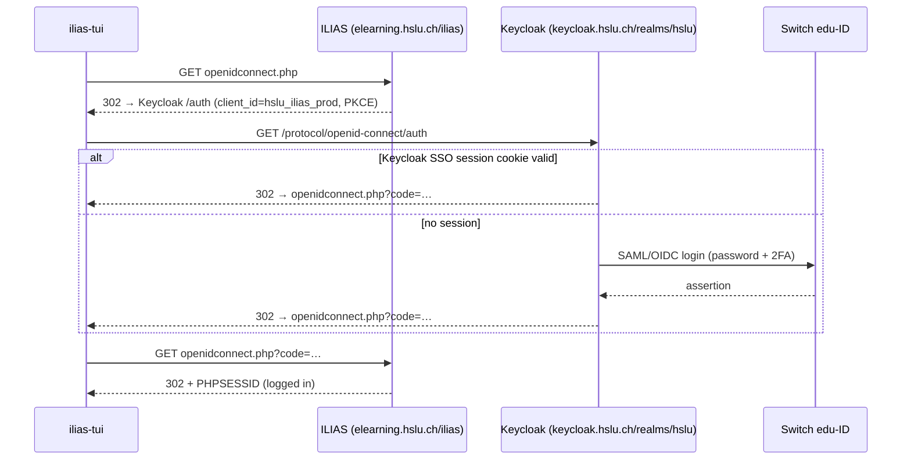

# Architecture

This document covers how ilias-tui logs in, how it gets data out of ILIAS, and how the TUI
is put together, so you can change or extend it.

```
src/
├── main.rs              CLI commands, config, startup login (connect)
├── icons.rs             Nerd Font glyph + colour per object/file type
├── theme.rs             Dark and light palettes, custom colours and UI glyphs; the one place to restyle
├── auth.rs              Interactive login in Chrome → CookieStore
├── session.rs           Cookie jar ⇄ private JSON file
├── clipboard.rs         `y`: copy a permalink (pbcopy on macOS, else the terminal's OSC 52)
├── downloads.rs         Saved files: path, ILIAS version, size + mtime when saved
├── sync.rs              Sync whole courses: plan per file, parallel downloads
├── cache.rs             Parsed pages on disk, for instant display (stale-while-revalidate)
├── seen.rs              What's new: page diff, and the unseen items per course on disk
├── ilias/
│   ├── mod.rs           HTTP client: session check, silent re-login, pages, downloads
│   ├── my_courses.rs    My courses: course list + favourites + To-Do, assembled
│   ├── pages.rs         The seam for page requests: Https, and FakeIlias for tests
│   ├── parse.rs         HTML → Page { tabs, blocks } (ILIAS 10 markup)
│   └── write.rs         Every write (favourites, handing in, logout) and the write guard
├── action.rs            Action enum (the app's messages)
├── app.rs               Event loop, side effects, action routing
└── components/
    ├── mod.rs           Component trait
    ├── browser.rs       Course/folder list with navigation stack
    ├── filter.rs        `/` search bar + matching
    ├── status_bar.rs    Footer messages
    ├── confirm.rs       Yes/no dialog in front of every write
    └── help.rs          Key binding overlay
```

## 1. Authentication

### Why not an API?

- **No usable API token.** ILIAS uses OpenID Connect only to log you in. Once you're in,
  it gives you a normal PHP session cookie, and none of its pages accept Bearer tokens.
  So even if we had a Keycloak token, ILIAS wouldn't take it.
- **SOAP and WebDAV are out.** Both need a local ILIAS password, which SSO accounts don't
  have.

The only reliable credential is therefore the **browser session**.

### The HSLU login chain

These redirects were observed on `elearning.hslu.ch`:



### First login (`auth::browser_login`)

1. `headless_chrome` starts a **visible** Chrome with a fresh, temporary profile and opens
   `openidconnect.php`.
2. The user logs in normally. We poll the tab URL every 300 ms and remember each URL we see
   (without its query string).
3. We stop once Chrome has left ILIAS and come back to an ILIAS page that is neither
   `login.php` nor `openidconnect.php`.
4. We fetch the cookies for every URL we saw via CDP `Network.getCookies`. Passing the full
   URLs matters: ILIAS cookies are scoped to `/ilias/` and Keycloak's to `/realms/hslu/`.
5. The cookies are copied into a `cookie_store::CookieStore`.

### Persisting (`session.rs`)

- The whole jar is stored as JSON in `<data dir>/<ilias host>.json`, created with mode
  `0600` (readable only by you):
  - macOS: `~/Library/Application Support/ch.ilias-tui.ilias-tui/`
  - Linux: `~/.local/share/ilias-tui/`
- This includes *session* cookies, which a browser would normally throw away. They are
  exactly the ones we need.
- `ilias-tui logout` deletes the file.
- The jar is saved after every login and when the TUI quits.
- The OS keychain was tried first and dropped: macOS ties a keychain item to the exact
  binary that created it, so after every `cargo build` the new binary could no longer read
  the session.

### Staying logged in (`ilias::Client`)

- `is_logged_in(page)`: the final URL is on the ILIAS host, it isn't `login.php`, and the
  HTML has no `cmd=force_login` link. Anonymous ILIAS pages always have that link.
- `silent_login()`: a plain `GET openidconnect.php` with redirects followed. If the Keycloak
  cookie is still valid, the whole chain from the diagram runs without a browser.
- `get_authed(url)`: fetch the page. If we're logged out, run `silent_login` and try once
  more. If that fails too, return `session expired: press L to log in again`.

`check_session` is the session check: logged in or not, renewing silently if possible. It
reads the course list to find out, and keeps that page (`checked_courses`); the next
`Client::course_list` / `my_courses` takes it once instead of fetching it again.

- **TUI** (`App::start`): the TUI comes up at once with My courses from the cache and runs
  the check on a worker. While it runs (`App::checking`), cached pages show without their
  background refresh, and My courses without a cached copy waits for it. Then the check
  sends `LoggedIn` (the browser reloads the page on screen and marks the levels below out
  of date), `Login` (session expired: Chrome opens) or `Offline` (ILIAS unreachable).
- **CLI** (`main::connect`): runs the check first and falls back to the browser login.

## 2. Reading ILIAS (`ilias/parse.rs`)

ILIAS 10 renders HTML on the server. `parse_page` turns a page into a `Page`:

```rust
pub struct Page { pub tabs: Vec<Tab>, pub blocks: Vec<Block>, pub todo: Vec<Item> }
pub enum Block {
    Heading(String),                              // h1–h4, page-editor headings
    Text(String),                                 // one paragraph / line of page text
    Items { title: String, items: Vec<Item> },    // an item group / content block
    Post(Post),                                   // a forum post (author, date, title, body, depth, unread)
}
pub struct Item {
    kind, ref_id, title, url,
    description,      // e.g. "Introduction to Examples"
    properties,       // e.g. ["pdf", "1.2 MB", "1. Mar 2026, 10:00"]
}
```

- **Tabs**: `#ilTab > li[id^=tab_]`. The active one has class `active`. Screen-reader text
  like "(Ausgewählte)" is removed.
- **Content**: `Walker` goes through `#il_center_col` in document order:
  - `.ilContainerBlock` / `.il-item-group` become `Items` blocks, titled by their header.
  - Headings become `Heading`.
  - Other block elements (`p`, `div`, `li`, …) become `Text` paragraphs.
  - It skips scripts, modals, action dropdowns, hidden elements and screen-reader text.
  - `form-group` rows (the Info tab) become `Label: value`.
- **Links in page text**: an `<a>` in text (not an item title) becomes a `link` item
  (`Walker::text_link`: title = link text, description = URL, id = a hash of the URL) and
  follows its paragraph in an untitled `Items` block, so the list keys reach it. Only
  `http(s)` links, each once per page, and none that `write::is_write` flags. `Enter` and `o`
  send `OpenInBrowser`; `App` turns an ILIAS link into `OpenLink` at once, asks first (`Ask`
  → `OpenLink`) for any other web link (also offline: it sends nothing to ILIAS), and
  refuses everything else. Forum posts still show text only.
- **Forum threads**: a page with `.ilFrmPostRow` rows is a thread; it becomes one `Post`
  block per row. The reply depth comes from the `ilFrmPost-level-N` class. A post is unread
  when its title links to `cmd=markPostRead`; that link is never followed. Viewing a thread
  does not mark posts as read on ILIAS (checked on HSLU).
- **Dashboard**: `parse_dashboard` reads two blocks: favourites (`block_dash_fav`, tiles:
  `.il-card` with a `.card-title a`) and To-Do (`block_pdtasks`, assignments with an
  upcoming deadline).
- **My courses** (`ilias/my_courses.rs`, see [CONTEXT.md](../CONTEXT.md)) is the one
  module that knows what the start page is made of. Callers use `Client::my_courses()`
  (the complete page) or `Client::course_list()` (where a deep search on My courses
  starts; no dashboard). Inside:
  - the course list and the dashboard are fetched in parallel; a failed dashboard still
    leaves the course list;
  - each To-Do exercise's page is fetched for its course (`course_title`, in parallel);
  - `assemble(course list, dashboard, now)` puts the year groups newest first
    (`newest_first`), the favourites on top with full course names, and the To-Do in
    `Page::todo`, soonest first with "due in …". Tests cover the whole page through it.
  
  `Page::todo` is apart from the blocks, so filters and deep search never see it.
  `Browser::draw_todo` shows it as a panel to the right (below on terminals narrower than
  100 columns); `Tab` on a page without tabs moves the keys into it (`todo_focus`).
- **Show more lists** (`Client::page`, `parse::show_more`): a container with a block
  limit lists only the first items of each block, then a "Show more" button
  (`li.ilContainerShowMore`). Its address is only in its script,
  `il.Container.initShowMore('<button id>', '<block>', 'ilias.php?…cmd=renderBlockAsynch&type=<block>…')`.
  The button POSTs the list ids of the items already shown (`ids[]=lg_div_<ref_id>_pref_<parent>`)
  and gets the next batch as a block fragment, with another button if there are more.
  `Client::show_all` does the same until no button is left (at most `MAX_SHOW_MORE`
  requests) and puts each batch after the last item shown (`Page::insert_after`, files get
  that item's folder path). Every caller of `Client::page` (browsing, sync, deep search)
  gets the complete list. A button it can't read, or a list it can't finish, adds a
  `CUT_SHORT` line to the page instead of leaving items missing silently. This POST only
  reads; `Client::more_items` sends it only to this ILIAS and only with
  `cmd=renderBlockAsynch`, and it is the one POST outside `write.rs`.
- **Favourite links**: `Walker::item` keeps the item's own `cmd=addToDesk` /
  `cmd=removeFromDesk` link from its action menu (`favorite_toggle`, only if its
  `item_ref_id` is the item's) and sets `favorite` when it is a remove link.
  `ilias/write.rs` (`Client::toggle_favorite`) checks the link again (https, same host,
  one of those two commands, same item) and GETs it, unless `ILIAS_DRY_RUN=1`. After a
  change, `Browser` reloads the page on screen and marks hidden levels that list the item,
  and My courses, as *out of date*; they reload once they are on screen again.
- **Handing in** (`H`, `Client::hand_in`): the `hand_in` dialog asks for a path, then `Ask`
  asks to confirm. The client reads the assignment's upload form, checks that both addresses
  are for that assignment on this ILIAS, posts the file (`Pages::post`; ILIAS stores it now),
  then posts the form's finishing step and checks that the file is listed.
- **Handed-in files**: `parse_page` turns an assignment's Submission tab into a `sub` item
  (in place of the overview's heading of the same name), so it opens as a level like any
  container. `H` and `X` there act for the nearest level above that isn't a `sub`.
- **Deleting a handed-in file** (`X`, `Client::delete_submission`): the submission page
  lists each handed-in file as a `file` item linking to its download (`…&delivered=<id>`).
  After `Ask`, the client reads the submission page, finds the form with that file and a
  `confirmDeleteDelivered` button (none after the deadline), checks it posts to that
  assignment on this ILIAS, posts it, then posts the confirmation page's `deleteDelivered`
  form the same way and checks that the file is gone.
- **Download folders**: `breadcrumb_path` takes the page's breadcrumb (ILIAS writes it
  leaf to root) from the course or group down, and every file on the page gets it as
  `Item::path`. `Client::download` saves into `<download dir>/<path…>/`, each part
  sanitised. Deep search results keep the path of the page they came from.
- **Permalinks** (`y`): `Browser` sends `CopyLink(item)` for the selected item (else the
  page's own); `App` builds `Item::permalink` with the client's base URL (`goto.php/<kind>/<ref_id>`,
  or the item's own link when it has no reference id) and `clipboard::copy` puts it in the
  clipboard, then `Copied` shows it in the status bar. No request is sent.
- **Icons**: `icons.rs` picks the glyph from `kind`, and for files from
  `Item::extension()`. That is the first property, where ILIAS shows the file type, with
  the title as fallback.

Item title links are found with two CSS selectors:

| Selector                  | Where it appears                                   |
| ------------------------- | -------------------------------------------------- |
| `a.il_ContainerItemTitle` | Contents of categories, courses, groups, folders   |
| `.il-item-title a`        | UI-framework lists (dashboard, memberships)        |

Each link's `href` is turned into `(kind, ref_id)` by `parse_target`, which understands
three link formats (plus a fallback, see below):

- ILIAS 10 permalinks: `goto.php/crs/123`. Used for most objects.
- Legacy links: `goto.php?target=crs_123`.
- Forum threads: `ilias.php?cmdClass=ilObjForumGUI&cmd=viewThread&ref_id=…&thr_pk=42`
  becomes `("thr", 42)`. All threads share the forum's `ref_id`, so they need their own id.
- Direct GUI links: `ilias.php?cmdClass=ilObjFileGUI&cmd=sendfile&ref_id=123`.
  **Files inside folders use this format.** The kind comes from the GUI class
  (`ilObjFileGUI` → `file`, `ilObjFolderGUI` → `fold`, …; see `kind_from_gui_class`).
- Fallback: links with only a `ref_id`, e.g. weblinks
  (`baseClass=ilLinkResourceHandlerGUI&ref_id=…`). The type comes from the item's icon
  (`icon_webr.svg` → `webr`).

Relative links are resolved against the ILIAS root, also on `goto.php/crs/123` pages.

Links without a ref id (imprint, language switch, …) and duplicates are dropped. Because
only *item title* links are selected, breadcrumbs and menus are ignored automatically.

URLs used:

| What        | URL                                                |
| ----------- | -------------------------------------------------- |
| My courses  | `ilias.php?baseClass=ilmembershipoverviewgui`      |
| To-Do       | `ilias.php?baseClass=ilDashboardGUI` (only the `block_pdtasks` block), plus `goto.php/exc/<ref_id>` per exercise for its course |
| A container | the item's permalink, e.g. `goto.php/crs/123`      |
| A download  | the item's `cmd=sendfile` link, else `goto.php?target=file_<ref_id>_download` |
| Deep search | `Client::descendants`: depth-first over all containers below the start (categories, forums and threads are skipped, at most 500 pages), titles become paths |

Downloads:

- If the response is `text/html` instead of a file, that means "not logged in / no access".
  We try `silent_login` once, then give up with an error.
- `Enter` on a file sends `Download { open: true }`. If `downloads.rs` knows a saved
  copy that still exists, `App` turns that into `OpenFile(path)` without any request.
  Otherwise it downloads, records the path in `<host>.downloads.json` next to the
  session, and opens the file with `open` / `xdg-open` / `start`. `d` sends
  `Download { open: false }`, which always fetches a fresh copy.
- The filename comes from `Content-Disposition` (`filename*=` first, then `filename=`).
- Names are sanitised and never overwrite an existing file; ` (1)`, ` (2)`, … is appended.

**When ILIAS changes its markup** (for example after an update), the lists come back empty.
To fix it:

1. Run `ilias-tui show <url>` to see what the parser makes of the page, and
   `ilias-tui dump <url> > page.html` for the raw HTML.
2. Adjust `Walker` or the selectors in `parse.rs`.
3. Add a test next to the existing ones in `parse.rs`. Use a small HTML snippet modelled
   on the real markup rather than a full page: course pages contain personal data.

## 3. The TUI: component architecture

The UI follows ratatui's
[Component Architecture](https://ratatui.rs/concepts/application-patterns/component-architecture/)
pattern: self-contained components that talk to each other only through `Action`
messages.

### The `Component` trait

```rust
pub trait Component {
    fn handle_key_event(&mut self, key: KeyEvent) -> Option<Action>; // input → intent
    fn update(&mut self, action: &Action) -> Option<Action>;          // react to anything
    fn draw(&mut self, frame: &mut Frame, area: Rect);                // render own state
}
```

Components never touch the network and never call each other. They only:

- turn keys into actions,
- update their own state from actions,
- draw that state.

### The loop (`app.rs`)

```
          key event
              │
              ▼
   ┌────────────────────┐  first Some(action) wins,
   │ Help → Filter →    │  top-most component first;
   │ Browser → StatusBar│  `q` only if nobody handled it
   └─────────┬──────────┘
             │ Action
             ▼
        mpsc channel ◀──────────── worker threads (network, login)
             │                              ▲
             ▼                              │
   App::dispatch(action) ── side effect? ───┘  (Load, Download, Login, OpenInBrowser)
             │
             ▼
   every component.update(&action)  ── may return a follow-up Action → channel
             │
             ▼
           draw
```

- **Key routing:**
  - `App::handle_key` handles `Ctrl-c` first.
  - Then it asks the components in z-order, top-most first: `Help`, `Filter`, `Browser`,
    `StatusBar`.
  - The first component that returns `Some` handles the key. That's how the help overlay
    swallows every key while it's open, and how the search bar gets the letters you type.
  - `q` quits only if no component handled it, so you can still type "q" into the search.
- **Side effects:**
  - `App::dispatch` runs actions that need I/O in `App::spawn`, which uses a thread plus a
    shared `Arc<Client>`.
  - The job also gets the action sender, so it can report progress, e.g. the deep search
    sends `Progress("Searching… 12 folders")`.
  - When the work finishes, the worker sends the result back as a new action (`Loaded`,
    `Downloaded`, `LoggedIn`) or as `Error(String)`.
  - The UI thread never blocks, so it redraws at about 20 FPS while requests run.
- **Broadcast:** every action, including the ones that started side effects, goes to every
  component's `update`. For example:
  - `Load` makes the status bar show "Loading…" and makes the browser remember what is
    pending.
  - `Loaded` clears the status bar and pushes a new level onto the browser.
- **Stale responses:**
  - `Browser` stores what it's waiting for (`pending` = ref id + deep flag).
  - If the user goes back before the response arrives, the late `Loaded` is ignored.

### Loading and caching

`App::dispatch(Load { item, url, refresh, deep })` decides where a page comes from:

**Offline mode** (`Client::set_offline`): every request (`request`, `download`, the
Keycloak probe) fails with `OFFLINE` before anything is sent. `main` turns it on
for `--offline` / `ILIAS_OFFLINE=1`, and `App::start` when the session check can't reach
ILIAS (an 8 s connect timeout keeps that quick; cached pages show meanwhile). `App` then answers every `Load` from the cache,
also `refresh: true` ones, with no background refresh, and an `Error` if the page was never
cached. A deep search walks the cached pages instead (`Cache::descendants`, sharing
`ilias::walk` with `Client::descendants`), so it finds everything below a synced course; it refuses `Ask` (writes) up front. `Login` first turns offline off and tries the
session check, and only opens Chrome if the session expired; if ILIAS still can't be
reached it goes back to offline.

**Sync** (`sync.rs`): `Client::descendants` lists every file below the chosen courses
(their folder path and the listing's size and date come with them). `plan` decides per file
from what `downloads.rs` recorded: `New`, `Update` (changed on ILIAS, copy untouched),
`Beside` (changed on ILIAS, copy edited), `Adopt` (old entry without version), `Unchanged`,
`Deleted`, `TooBig`. "Edited" means size or mtime differ from right after the download;
old entries count as edited, so nothing saved before is ever overwritten. Downloads run 3
at a time into fresh files, then replace or sit beside. The sync job writes the index
itself (`Downloads::update` re-reads the file first, so it and the TUI don't drop each
other's entries); `Synced` makes `App` read it again.

The crawl uses `Client::descendants_with_pages`, which hands every course and folder page it
reads to a callback; sync puts them in the page cache under the key the TUI uses when it
opens that item (`Cache::key(item.url)`), so a synced course can be browsed offline. The
`Summary` counts everything for the status bar and lists the files worth a look (`report`:
skipped for size, saved beside, failed); the `Report` overlay shows them after the sync.

**What's new** (`seen.rs`, see [CONTEXT.md](../CONTEXT.md)): `Cache::update` stores a
freshly fetched page and returns `seen::diff` against the copy it replaces: the items with a
ref id the old copy lacks, or with other properties. Relative dates are made absolute with the
day each copy was fetched (the cache file's mtime), and countdowns are left out, so a page
that didn't change gives nothing. No cached copy, no diff.

- `App::fetch` (a page on screen) sends the diff as `NewItems`; `Browser` marks those items
  `● new` for the rest of the run. Nothing is stored: you are looking at it.
- Sync diffs every page it caches (`Summary::unseen`, by sync root) and the job records them
  in `Seen` (`<host>.seen.json` next to the session) as unseen. On `Synced` the app reads the
  file again and sends `NewCounts`; `Browser` shows `● 3 new` on those courses.
- A `Load` of a container (online or offline) calls `Seen::open`, which takes the unseen
  items of that container, and of all its folders if it is a course, and sends them as
  `NewItems`. So opening a course marks it seen, and its new files stay marked while you
  browse it.

My courses has no special case: on the first start with an empty cache it takes ~2–3 s
(course list, dashboard and the To-Do exercises), later starts show the cached copy. Its
refresh reads the course list (or takes the session check's) and the dashboard; the To-Do's
courses come from the cached copy (`my_courses_after`, kept in each entry's `path`), so an
exercise page is only read for a new exercise.

1. **Cache hit** (only when `refresh` is false): send `Loaded` with the cached page right
   away, then queue `Load { refresh: true }`. The browser shows the cached page.
   - The refresh fetches the page from ILIAS, writes it to the cache and sends
     `Loaded { refresh: true }`.
   - `Browser` replaces the top level only if the page actually changed, so the cursor and
     scroll position don't jump.
   - If the user has moved on, the stale-response check drops it.
2. **Otherwise:** `App::fetch` loads the page on a worker thread and writes it to the
   cache.

Cache keys are `"{deep}|{url}"` (the tab URL, the item URL or `courses`), hashed with
FNV-1a into `<data dir>/cache/<host>/<hash>.json`. Tab switches and `r` set
`refresh: true`, so they always go to the network. Deep search results are cached too:
pressing `s` again shows the last result at once while it re-crawls.

**Deep search** (`Client::descendants`) runs in two phases:

1. Fetch the tree one level at a time. `fetch_children` uses `PARALLEL` (6) scoped
   threads that share one `Client`.
2. Walk the collected tree in display order to build the path titles.

ILIAS serves parallel requests of one session without locking. Measured: 6 folders took
0.7 s in parallel vs 3.6–6 s one after another. The crawl stops after `MAX_CRAWL` (500)
pages.

### Mouse

- `main` turns on crossterm's mouse capture, unless `ILIAS_MOUSE=0`. It turns it off again
  on exit and on panic.
- `App` routes `Event::Mouse` like keys: `Component::handle_mouse_event`, top-most
  component first, and the first `Some` wins. `Help` swallows clicks while open.
- **Hit-testing:** while drawing, `Browser` records a `(Rect, Hit)` for every clickable
  thing:
  - each visible item row (heights come from `ListItem::height`, starting at the list's
    scroll offset),
  - each tab pill,
  - each breadcrumb.

  `handle_mouse_event` looks up the click position in that list. Hit areas are therefore
  always exactly what is on screen, including after scrolling or resizing.
- **Double-click:** a second click on the same item within 400 ms opens it.
  - Clicking a breadcrumb truncates the stack to that level.
  - Clicking a tab loads it like `Tab` does.

### Search

- **Filtering.** `Filter` holds the query and turns typing into `Action::Filter(query)`.
  `Browser` keeps, for the current level, the indices of matching items (`visible`), and
  the `ListState` selection indexes into that list.
- **Matching.** Every word of the query must appear in the title, ignoring case
  (`filter::matches`).
- **Per list.** Each `Level` keeps its own `query`. A new list starts unfiltered (the
  browser emits `Filter("")`, so the bar clears too). Going back (`Esc`, `h`, a breadcrumb)
  emits the level's own query, so the bar shows it again; the level isn't filtered again,
  so the selection stays where it was.
- **Deep search.** `s` sends `Load { deep: true }`. The worker calls
  `Client::descendants`. The result is pushed as its own level ("Search in X"), with path
  titles. On `Loaded { deep: true }`, `Filter` opens the bar right away, so you can start
  typing.

### Components

| Component   | State                                    | Notes                                    |
| ----------- | ---------------------------------------- | ---------------------------------------- |
| `Filter`    | `query`, `editing`                       | One line above the status bar, shown while editing or filtering. |
| `Browser`   | stack of `Level { item, deep, page, items, query, visible, cursor, list }` | Tab bar, then the page laid out as rows: headings, wrapped text, items with icon and details. Only item rows can be selected. `Tab` loads another tab into the same level. Back = pop (no request, unless the level went out of date while hidden: then it reloads once). `r` refreshes the top level. Only responses for the page asked for last are applied. |
| `StatusBar` | `Status` (idle/busy/done/info/error), start time | Spinner while busy, ✓ / ⚠ icons for results and errors; key hints on the right. |
| `Help`      | `visible: bool`                          | Overlay drawn last, on top of everything. Keys come from `help::KEYS`, grouped into sections. |
| `Report`    | the last sync's report lines, `scroll`   | Overlay after a sync that skipped, kept or failed files. `j`/`k` scroll, any other key closes. Keys it uses up return `Action::Handled`. |
| `Confirm`   | `pending: Option<(question, Action)>`    | Yes/no dialog, first in the z-order. `Action::Ask { question, then }` opens it; `y` sends `then`, anything that cancels sends `Cancelled`. Every write goes through it, and opening a link to another site. |

### Look

- **Colours and glyphs** all come from `theme.rs`. Components never hard-code colours, so
  restyling is a one-file change. Icons fall back to plain Unicode when
  `ILIAS_NERD_FONT=0`.
- **Header** (`Browser::draw_header`): logo pill, breadcrumb and the current object's
  description, on ILIAS navy. Middle crumbs collapse to "…" when the terminal is too
  narrow.
- **Tabs** (`tab_bar`): pills, with the active one filled.
- **Content**: a rounded frame with horizontal padding and a scrollbar once the rows
  overflow.
  - Section headings get an accent bar `▍`.
  - URLs in page text are underlined.
  - The selected item gets a `▌` marker and a background.
  - While filtering, matched words in titles are highlighted (`highlight`).

### Adding a feature

The `/` filter is a complete example of a feature built this way. Look at `filter.rs`
and how `Browser` reacts to `Action::Filter`. To add your own:

1. Add the new `Action` variant(s) to `action.rs`.
2. Put the state and keys in a component, either a new one in `components/` or an
   existing one.
3. If it's a new component, register it in `App`, in `App::components()` at the right
   z-order position, and draw it in `App::draw`.
4. Let other components react to the new action in their `update`.
5. Add the key to `help::KEYS` and the README.

If the feature needs ILIAS data, add a method to `ilias::Client`, then a matching
`Action::Xxx` / `Action::XxxLoaded` pair. Spawn it from `App::dispatch` like `Load`.

## 4. Testing

`cargo test` runs:

- **Parser tests** (`ilias/parse.rs`) against real public HSLU pages in `tests/fixtures/`.
- **Client tests through the `Pages` seam.** `Client` sends every page request to a
  `Pages` adapter: `Https` in the app, `FakeIlias` in tests (answers from a closure, records
  the URLs asked for). With it the tests cover silent re-login and its failure, the write
  guard, deep search order and limits, the complete My courses (also without a working
  dashboard), favourites changes (exactly one request; none in dry-run mode) and logout.
  For trying things against a real server there is a throwaway ILIAS in Docker
  (`dev/README.md`).
  The `App` tests use an offline `FakeIlias`, so no test reaches the network. File
  downloads and the Keycloak probe bypass the seam.
- **Download helpers** (`ilias/mod.rs`): `Content-Disposition` parsing and filename
  sanitising.
- **Component tests** (`components/browser.rs`, `components/filter.rs`): they drive the
  components with key events and actions, and render them into ratatui's `TestBackend` to
  check the output. This covers navigation, stale responses, filtering and deep search.
  No terminal or network is needed.

CI (`.github/workflows/ci.yml`, GitHub Actions) runs `cargo test` and
`cargo clippy --all-targets -- -D warnings` on macOS and Linux for every push to `main` and
every pull request, and `cargo audit` against the RustSec advisories (also weekly, since new
advisories appear without code changes). No test reaches the network, so CI needs no ILIAS.

The login itself and the real HTML of logged-in pages can't run in CI, because they need
your edu-ID. Test those by hand with `ilias-tui login`, `ilias-tui ls …` and
`ilias-tui dump …`.

**The write guard.** `Client::request` is the one place page requests leave the client.
It refuses URLs that `write::is_write` flags (an `rtoken`, or a command in
`WRITE_COMMANDS`) unless the caller is the write path (`write.rs`: `toggle_favorite`,
`logout`). When ILIAS gains a write command ilias-tui might see in a link, add it there.
